# Butler — Data & Code Flow

How data moves through Butler, and which code handles each step. The diagrams are
[Mermaid](https://mermaid.js.org/) and render on GitHub and in VS Code's Markdown
preview.

> **Keep this file current.** Any change to a flow below (a new command, a new
> cache, a changed timing, a new log) updates the matching diagram in the same
> commit. Numbers in diagrams (debounce, timeouts, caps) must match the code.

## 1. Components

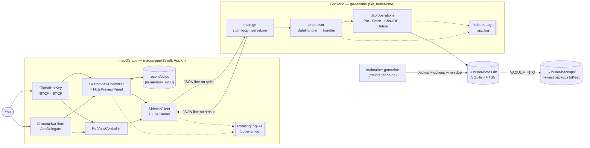

The app starts `butler-core` once at launch and keeps it running. They talk over
the backend's **stdin/stdout pipes**, one JSON object per line. The backend owns
the database and `app.log`; the app owns the UI, the in-memory recent-notes list
and `butler-ui.log`.

## 2. Wire protocol

One request per line from the app, one response per line back, matched by `id`.

| `cmd` | Request fields | Response | Backend function |
|---|---|---|---|
| `ping` | — | `ok` | — |
| `put` | `key`, `value` (both trimmed; must be non-empty) | `ok` | `operations.PutNote` (upsert by key) |
| `fetch` | `query` (`""` = most recent) | `ok`, `notes[]` (≤ 200) | `operations.FetchNote` → FTS5, LIKE fallback |
| `list` | — | `ok`, `notes[]` (≤ 200) | `operations.ShowDB` |
| `delete` | `note_id` | `ok` | `operations.DeleteNote` |

Every response is `{"id": …, "ok": true|false, "notes"?: […], "error"?: "…"}`.
A `Note` is `{id, key, value, created_at, updated_at, rank}`. The Swift
`Models.swift` mirrors the Go `dao.Note`, and `ModelsTests` pins the contract.

## 3. Opening search (⌘⌥F)

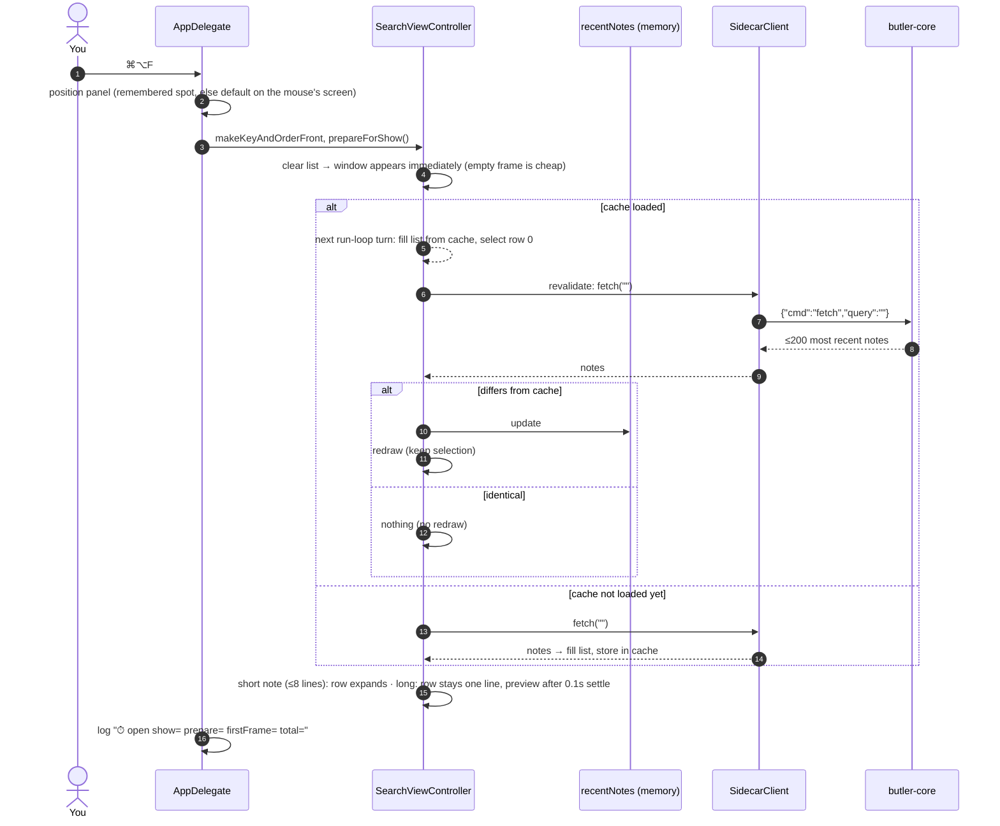

Filling the list must stay **after** the window appears. Doing it before the
first frame delayed every open by about 200ms.

## 4. Typing a query

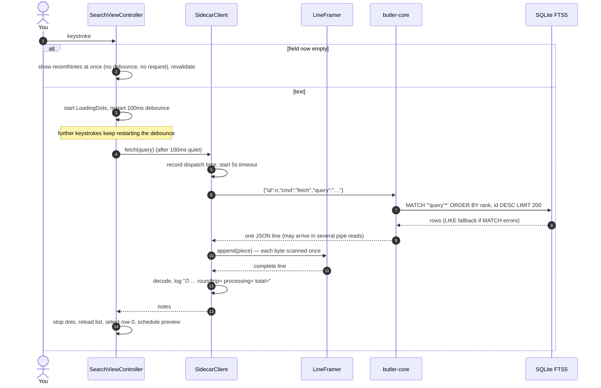

## 5. Saving a note (⌘⌥P)

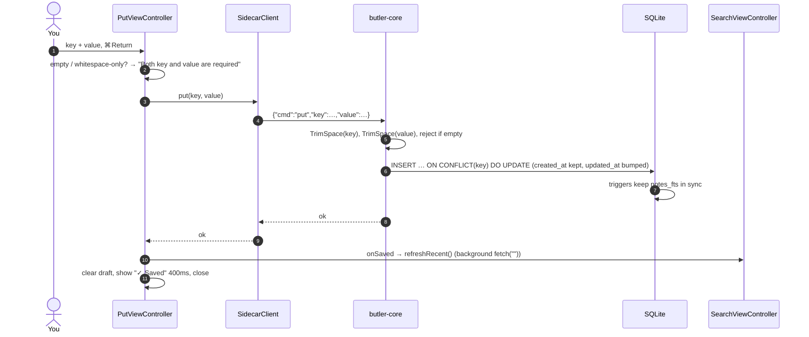

## 6. Deleting a note (⌘D in search)

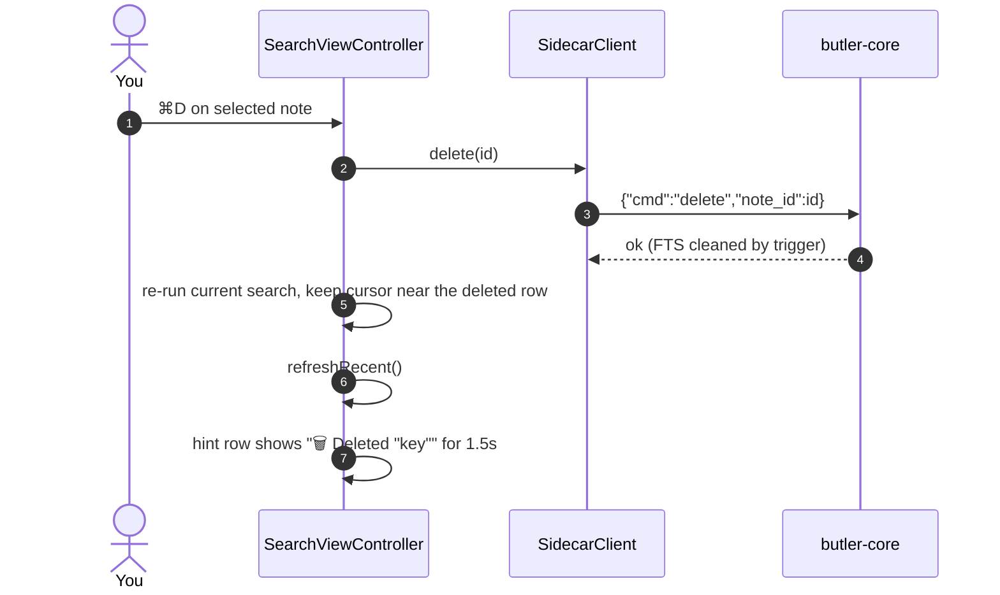

## 7. Recent-notes cache lifecycle

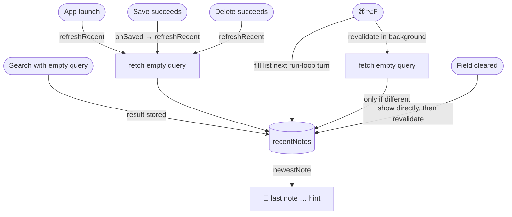

The cache is never "invalidated". It's refreshed at every point where notes can
change, and the revalidation on open catches anything else, such as a backend
hot-swap.

## 8. Backend request pipeline

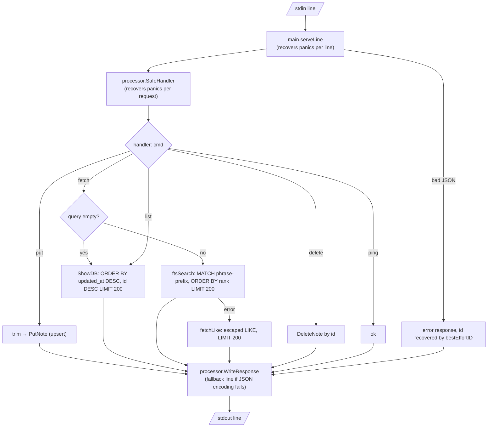

## 9. Database upkeep and backups

Runs on its own goroutine (`maintainer.run`), next to the request loop. The
schedule constants are listed in [RUNBOOK.md](RUNBOOK.md#backups); they're
referred to here by name.

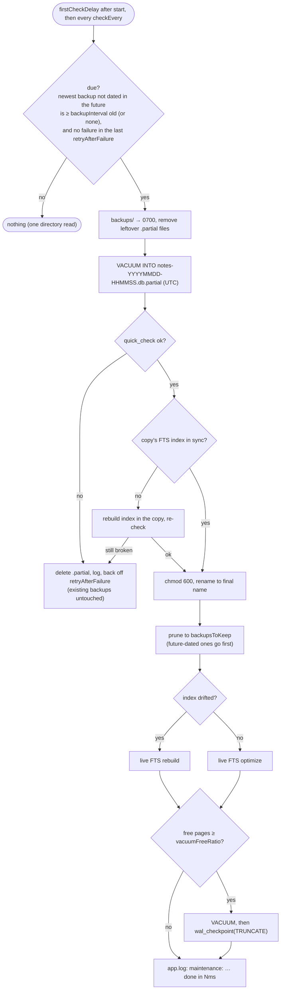

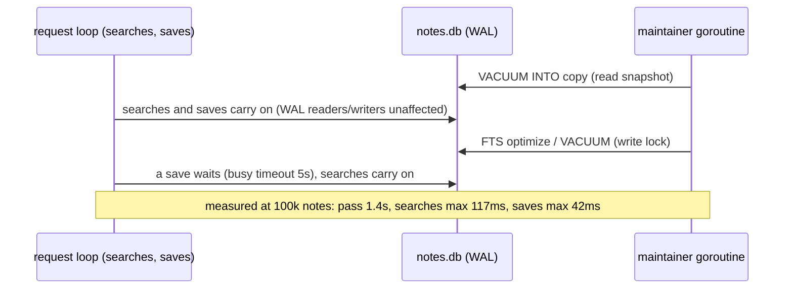

Restoring is manual; see [RUNBOOK.md](RUNBOOK.md).

## 10. Resilience

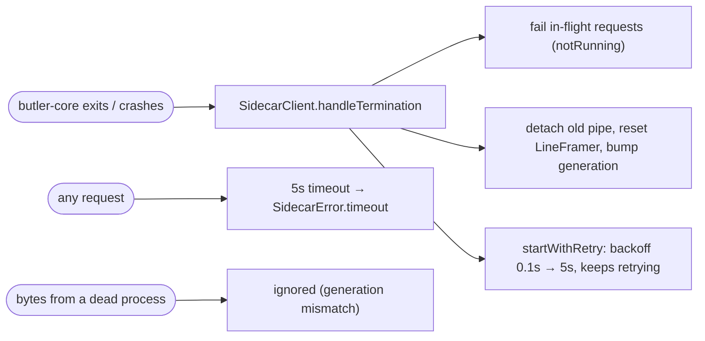

## 11. Logging

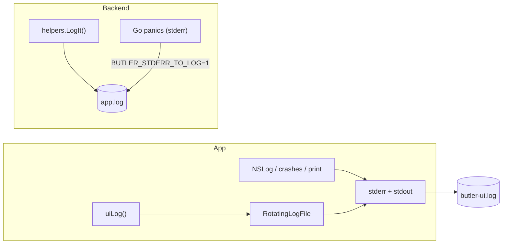

Both logs:
- **Rotate at 1MB, keeping 3 backups.** Rotation moves the full log aside and opens the fresh file before shifting backups, so a failed rotation loses nothing and retries after 60s.
- **Stay open, with the size tracked by a counter**, so there's no stat call per line.
- **Re-check every 5s** that the file is still there, and reopen it if it was deleted by hand.
- **Are private** (`0600`).

**Note text is never logged:** saves and deletes log only the key and the length.

## 12. "Last note" hint

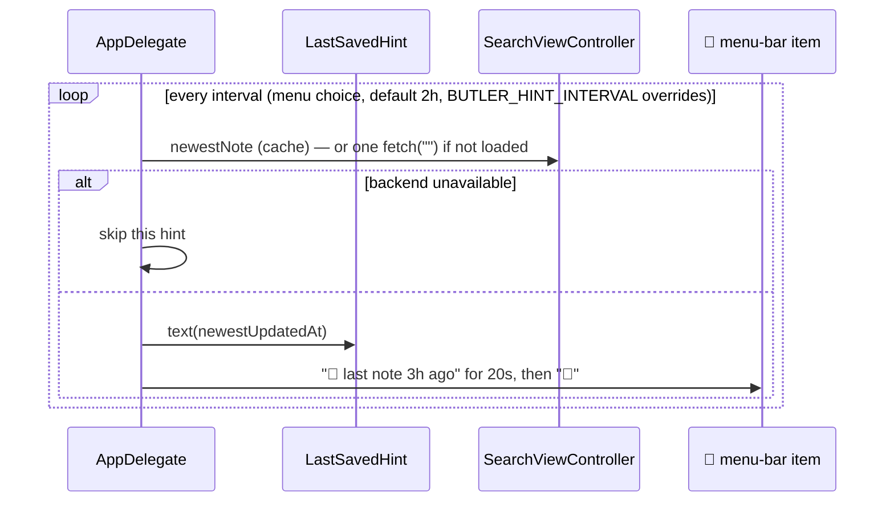
